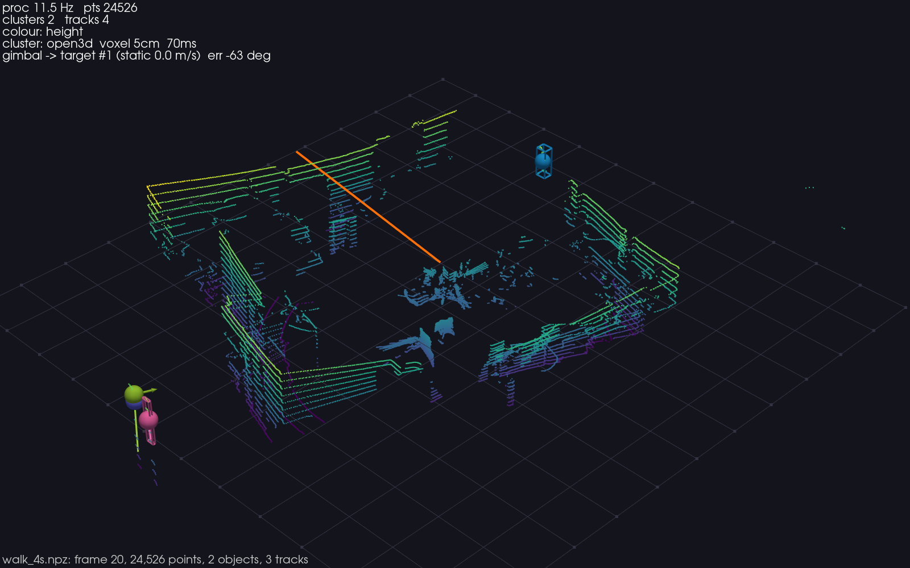
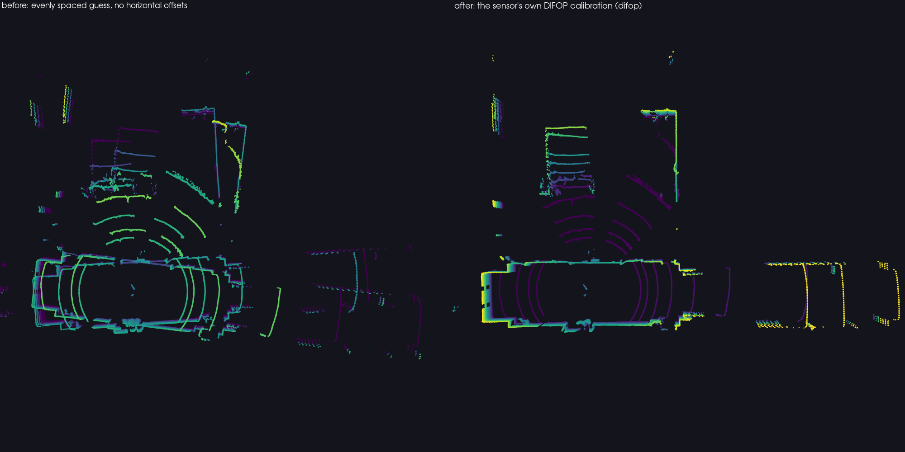
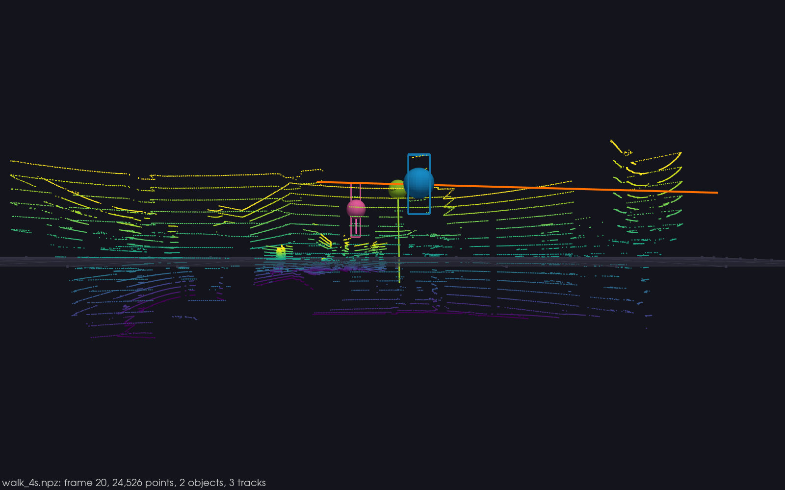
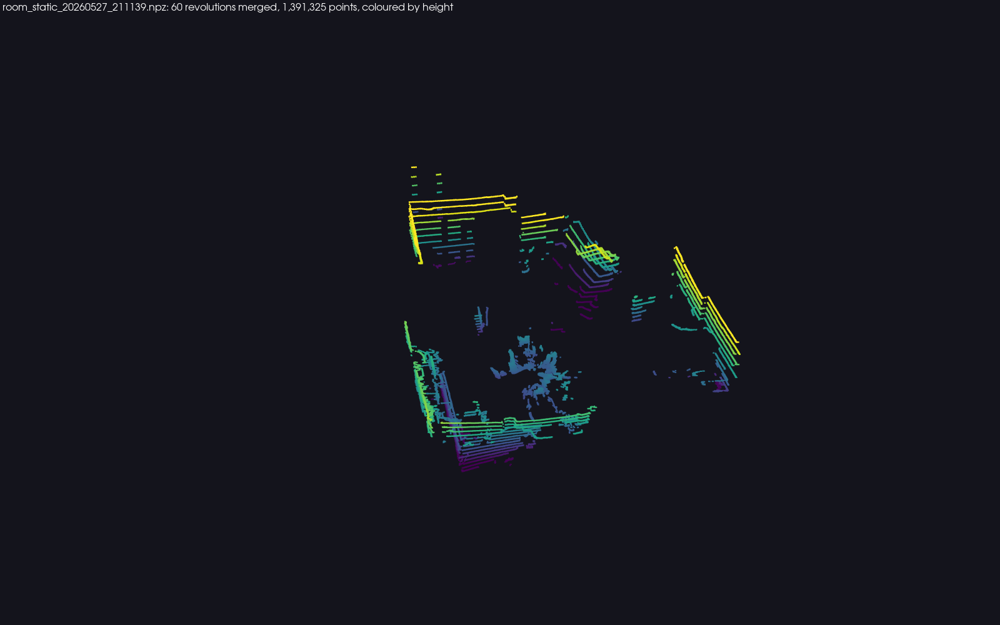

# helios16p

**The RoboSense Helios 16P LiDAR in Python.** A numpy decoder for the sensor's
UDP stream, recording and replay, a perception pipeline (ground removal,
clustering, multi-object tracking, a virtual gimbal) and an interactive 3D
viewer. Works with or without ROS, on a laptop, from a real recording that
ships inside the package.



## A few minutes to a point cloud

```bash
python3.12 -m venv .venv && source .venv/bin/activate     # Python 3.10 to 3.12
pip install git+https://github.com/Sach279/helios16p.git@v0.2.0
helios16p-demo                                            # replays the bundled 4 s recording
```

The install is about 2.4 GB (Open3D and VTK) and takes a few minutes. No
`python3.12` on your machine? `uv venv -p 3.12` or `conda create -n helios
python=3.12` get one; Python 3.13 waits for an Open3D wheel.

A window opens with the room, the walking person boxed and tracked, and a HUD.
Orbit with the mouse, press `1 2 3` to colour by height, intensity or beam,
`Q` to quit. No sensor, no ROS, no data download needed.

With the sensor plugged in (host NIC on `192.168.1.102/24`, sensor at
`192.168.1.200`, no sudo needed, ports are above 1024):

```bash
helios16p-demo --source udp                  # live; a warning after 3 s tells you what to check if nothing arrives
helios16p-record --name lab --seconds 30     # raw packets to ./recordings/lab_<date>.npz
helios16p-demo --rec recordings/lab_20261104_120000.npz    # replays as it was seen live
```

## What is in the box

| command | what it does |
|---|---|
| `helios16p-demo` | the viewer: `--source file` (default, bundled clip), `udp`, `mcap`, `ros`, `synthetic`; `--viewer none` prints statistics only |
| `helios16p-record` | records MSOP and DIFOP packets with host timestamps, one `.npz` per session |
| `helios16p-info` | packets, duration, frames, rpm, return mode and the calibration of a recording; `--save-calib` |
| `helios16p-export` | PLY with x y z, intensity and ring (one dense cloud or one file per frame) for CloudCompare, MeshLab, Open3D |
| `helios16p-snapshot` | off-screen PNG renders of a recording (figures, CI, headless machines) |
| `helios16p-trim` | cut a recording to a time window so it can be shared |
| `helios16p-import-pcap` | turn a tcpdump, Wireshark or RSView capture into a recording |
| `helios16p-validate` | compare this decoder with the vendor driver's cloud on the same packets |

Every command works on the bundled clip when `--rec` is omitted, and answers `--help`.

Python API: `PacketFileSource`, `UdpSource`, `McapSource`, `RosSource`,
`SyntheticSource` all yield `Frame` objects (`points`, `intensity`, `ring`,
`timestamp`); `ProcessingPipeline(cfg).process(frame)` returns detections,
tracks and the control output; `helios16p.calibration` reads and writes the
sensor's angle tables.

```python
from helios16p import PacketFileSource, bundled_clip

for frame in PacketFileSource(bundled_clip(), max_frames=3):
    print(frame.frame_id, frame.num_points, frame.points.mean(axis=0))
```

Frame 0 is the partial revolution the recording starts in; full revolutions
follow at 10 Hz with about 24,000 points each (28,800 is the sensor's maximum
at 600 rpm, single return).

## The decoder is checked against the vendor

The sensor sends its own per-beam calibration (the DIFOP packet): the beams
fire interleaved (+13°, +15°, +9°, +11°, ...) and each has a horizontal offset
of several degrees. This package reads both tables and applies them, and
`helios16p-validate` measures the result against RoboSense's rs_driver on the
same packets (one corridor station, 22,501 packets, 200,000 sampled points):

| decode | median distance to the nearest vendor point | within 1 mm |
|---|---|---|
| **helios16p 0.2** (DIFOP vertical and horizontal) | **float32 rounding (0.0001 mm)** | **99.99 %** |
| vertical table only | 53 mm | 3 % |
| evenly spaced guess (helios16p 0.1) | 112 mm, and 0.56 m point to point | 0.5 % |

This is agreement between two decoders of the same bytes, not the sensor's
ranging accuracy (for that, see the RoboSense datasheet). A 150-packet slice of this check
ships with the tests and runs in CI.



Details, byte offsets and history in [docs/07-calibration.md](docs/07-calibration.md).

## More pictures

| | |
|---|---|
|  |  |
| the sixteen beams, lowest in purple (`ring` 0) to highest in yellow | a static room, sixty revolutions merged, coloured by height |

## How it is built

```
  sensor / recording / bag / topic          Frame                        FrameAnnotations
  ┌──────────────────────────────┐  ────────────────▶  ┌───────────────────┐  ───────────────▶  ┌───────────────┐
  │ Source (udp, file, mcap,     │   points, intensity │ ProcessingPipeline│  detections,      │ PyVista viewer│
  │ ros, synthetic)              │   ring, timestamp   │ ground · cluster  │  tracks, control  │ or Open3D,    │
  └──────────────────────────────┘                     │ track · control   │                   │ or snapshot   │
                                                        └───────────────────┘                   └───────────────┘
```

- **UDP decoder** (`helios16p/sources/udp_source.py`): numpy over the MSOP wire
  format, 12 blocks × 32 channels per 1248-byte packet, azimuth interpolation
  and the spherical-to-Cartesian geometry of the vendor driver; 750 packets per
  second at 600 rpm decode in well under real time. Live and replay share the
  range window (0.1 to 180 m) and the frame split, and a test streams the
  bundled packets over loopback to check they agree point for point.
- **Calibration** (`helios16p/calibration.py`): DIFOP parser, bundled fallback,
  JSON save/load. See the table above for why it matters.
- **Pipeline** (`helios16p/processing/`): RANSAC ground plane (seeded, so a
  run repeats), DBSCAN clustering (Open3D C++ or scikit-learn, switchable live
  with `C`), Kalman tracks with Hungarian assignment, and a virtual gimbal that
  keeps the chosen track centred.
- **Viewers** (`helios16p/viz/`): PyVista/VTK (default, works on X11 and
  XWayland) and Open3D; the snapshot tool renders the same scene off screen.

Documentation index: [docs/README.md](docs/README.md) (overview, architecture,
the UDP path, ROS 2 path, protocol notes, design decisions, performance, usage,
calibration). A short tour for presenting it is in [DEMO.md](DEMO.md).

## Install notes

- **Hardware:** the sensor, its interface box (power and 100Base-T1 to RJ45)
  and an Ethernet port on the host.
- **Platform:** tested on Linux (Ubuntu). Windows and macOS have wheels for every
  dependency but have not been tried; reports welcome.
- **Address:** give the host NIC an address on the sensor's subnet.
  Linux: `nmcli con add type ethernet ifname <NIC> con-name helios-lidar ipv4.method manual ipv4.addresses 192.168.1.102/24`
  then `nmcli con up helios-lidar`. Windows: Settings, Ethernet, IP assignment
  Manual, 192.168.1.102, mask 255.255.255.0. macOS: System Settings, Network,
  the adapter, Details, TCP/IP, Configure Manually. The sensor does not answer
  ping; `helios16p-demo --source udp --viewer none` says within 3 s whether
  packets arrive.
- **Firewall:** inbound UDP 6699 and 7788 must be open. Ubuntu:
  `sudo ufw allow 6699,7788/udp`; Fedora: `sudo firewall-cmd --add-port=6699/udp --add-port=7788/udp`;
  Windows: allow Python through Defender Firewall when asked.
- **Other ports or two sensors:** `--msop-port`, `--difop-port` on `helios16p-demo`
  and `helios16p-record`; `--device-ip` on `helios16p-demo` keeps one sensor's packets.
- **Recordings:** `./recordings/`, about 0.94 MB per second raw (750 × 1248 bytes),
  about 2.4 GB per hour compressed; the recorder keeps a session in memory and
  writes it at the end, so keep sessions to minutes.
- **Another Helios 16P:** its DIFOP overrides the bundled calibration
  automatically, live and in recordings made with `helios16p-record`. For a
  capture without DIFOP, save your sensor's tables once
  (`helios16p-info --rec x.npz --save-calib my.json`) and pass `--calib my.json`.
- **ROS 2** is optional: `--source mcap` reads a bag without ROS (`rosbags`),
  `--source ros` needs a sourced ROS 2 Jazzy for `rclpy`. The vendor's own ROS 2
  driver is documented in [docs/03-ros-and-vendor.md](docs/03-ros-and-vendor.md).
- **Tests:** `pip install -e ".[dev]"` from a checkout, then `python -m pytest -q`
  (a few seconds, no hardware). The full-station vendor comparison needs a
  recording and its rs_driver cloud (`HELIOS16P_PARITY_REC`, `HELIOS16P_PARITY_PLY`).

## Limitations

- Validated for 600 rpm, single return (the sensor's defaults); a DIFOP that
  reports anything else triggers a warning, and dual return is decoded as single.
- `Frame.timestamp` is the host clock at the first packet of the revolution;
  the sensor's own timestamps and per-point times are not exposed yet.
- The live viewer needs a display; off-screen renders do not.

## Citing, contributing, provenance

```bibtex
@software{sachdeva2026helios16p,
  author  = {Sachdeva, Akshit},
  title   = {helios16p: the RoboSense Helios 16P LiDAR in Python},
  year    = {2026},
  version = {0.2.0},
  url     = {https://github.com/Sach279/helios16p}
}
```

Bugs: open an issue with the output of `helios16p-info --rec <file>`, your OS
and Python version. Pull requests: `pip install -e ".[dev]" && pytest -q`
should stay green.

Written by Akshit Sachdeva during an MRes at Edinburgh Napier University
(School of Computing, Engineering and the Built Environment, BE-ST
scholarship), where the Helios 16P provided the metric reference for a thesis
on surveying traditional Scottish building interiors with a nano-UAV. The
calibration error was found when that reference was cross-checked against the
vendor driver, and the fix is what makes this release shareable.

MIT licence ([LICENSE](LICENSE)); citation metadata in [CITATION.cff](CITATION.cff).
Wire-protocol constants follow RoboSense's open-source rs_driver (BSD 3-Clause);
no vendor code runs here. Changes in [CHANGELOG.md](CHANGELOG.md).
