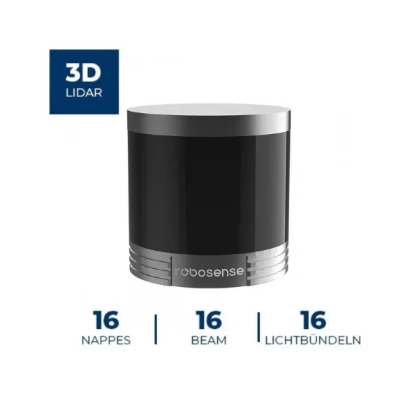
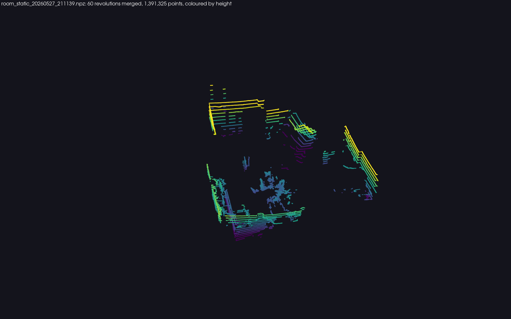
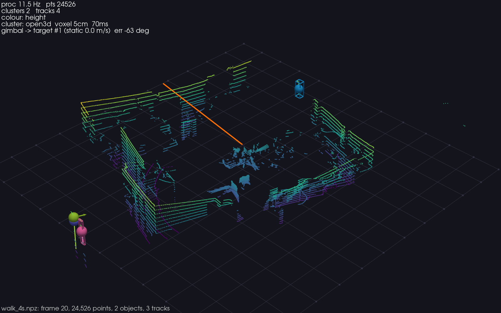

# helios16p — Overview

## What is this project?

`helios16p` is a pure-Python, real-time perception and visualization stack for the
**RoboSense Helios 16P** spinning LiDAR. It runs with or without ROS. Given a live
sensor (or any of four offline replay modes), it:

1. Decodes raw UDP packets from the wire using a custom numpy decoder — no vendor
   SDK, no ROS at runtime.
2. Passes each 360° frame through a perception pipeline: ground removal →
   DBSCAN object clustering → constant-velocity Kalman tracking → virtual gimbal
   control loop.
3. Renders an interactive 3D view with per-object labels, velocity arrows,
   trail history, and a virtual gimbal ray, via PyVista/VTK.

The scope: standard methods, integrated; not methods-novel research.
Every individual technique (RANSAC, DBSCAN, Kalman, Hungarian matching) is
well-established. The value is a self-contained, ROS-free stack that produces
clean per-frame perception output from a raw UDP stream — a platform suitable for
evaluation and demonstration.

---

## Why a LiDAR?

### Direct motivation

The sensor was acquired as the metric reference for an MRes thesis at Edinburgh
Napier University on surveying traditional Scottish building interiors with a
nano-UAV: the photogrammetric reconstructions of that work needed an
independent, metrically calibrated point cloud to be scored against. A LiDAR is
the natural answer, and the cross-check of this decoder against the vendor
driver (`07-calibration.md`) came out of building that reference.

### Sensor choice rationale

The Helios 16P is a 16-beam, 360° spinning LiDAR with a 30° vertical field of view
(±15°), a 150 m range (110 m at 10% reflectivity), a ~1 kg form factor
(≈ Ø100 × H100 mm), and a 100Base-T1 Ethernet interface. At 10 Hz spin rate it
produces about 24,000 to 25,000 points per revolution indoors (28,800 at most: 75 packets × 384 returns at 600 rpm, single return), or roughly
288,000 pts/s in single-return mode. The Ethernet interface with a documented,
re-implementable wire protocol (MSOP/DIFOP UDP) was a key selection criterion: the
full decode logic is reproducible from the BSD-licensed `rs_driver` source without
running any proprietary binary at measurement time.

---

## Headline capabilities

- **No-ROS live operation**: bind two UDP sockets, decode MSOP packets with numpy,
  yield `Frame` objects, decoded with the sensor's DIFOP calibration
  (per-laser vertical angles and horizontal offsets, `07-calibration.md`).
- **Five swappable sources** behind a common `Source` ABC: `udp` (live), `mcap`
  (ROS 2 bags via `rosbags`, no ROS install needed), `file` (raw-packet `.npz`
  replay with the identical decoder), `ros` (live via rclpy, lazy-imported), and
  `synthetic` (parametric test fixture).
- **Real-time pipeline at 20–30 Hz** on ≈25k-point frames, achieved with a 5 cm
  voxel downsample of the clustering input. Without the downsample, naive full-res
  DBSCAN runs at about 5 Hz (DBSCAN-bound). The voxel step is the decisive lever,
  not the choice of C++ vs Python backend.
- **Multi-object tracking** with a constant-velocity Kalman filter (6-DOF state),
  Hungarian assignment, and a configurable gate / confirmation threshold.
- **Virtual gimbal** that selects the fastest confirmed moving track (walking
  person), ignoring static furniture, and slews a simulated azimuth toward it with
  a P-controller and a 5°/step slew limit.
- **Interactive 3D viewer** (PyVista/VTK) with keyboard and on-screen widget
  controls, live backend and voxel-size toggling, and PLY export to CloudCompare.
- **Raw-packet recording** (`helios16p-record`) stores 1248-byte MSOP payloads + host
  timestamps in `.npz` for exact offline replay without the sensor.

---

## Figures

**Figure 1.** RoboSense Helios 16P — 16-beam, 360°×30° spinning LiDAR, ≈1 kg,
100Base-T1 Ethernet. Image: generationrobots.com / RoboSense.

---

**Figure 2.** A static room, sixty revolutions merged (about 1.3 million
points), height-coloured with the viridis colormap (`helios16p-snapshot --merge 60`).

---

**Figure 3.** One frame of the bundled clip through the pipeline: ground removed,
objects boxed, confirmed tracks as spheres with velocity arrows, the virtual
gimbal's aim ray in orange, statistics in the HUD.
