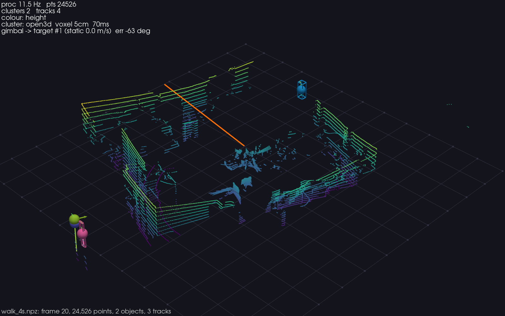

# helios16p — Architecture

## Layered design

The codebase is structured in four layers with strictly downward dependencies:

```
┌──────────────────────────────────────────────────────────────┐
│  sources/          Frame producers — the only I/O boundary   │
│  (udp, mcap, file, ros, synthetic)                           │
├──────────────────────────────────────────────────────────────┤
│  processing/       Pure-function perception stages           │
│  (ground, clustering, tracking)                              │
├──────────────────────────────────────────────────────────────┤
│  control/          Closed-loop output stage                  │
│  (gimbal.VirtualGimbal)                                      │
├──────────────────────────────────────────────────────────────┤
│  viz/              Display (read-only view of annotations)   │
│  (pyvista_viewer.PyVistaViewer)                              │
└──────────────────────────────────────────────────────────────┘
```

`pipeline.ProcessingPipeline` wires the middle two layers into a single call.
`types.py` and `config.py` are the shared contracts every layer imports; nothing
else crosses layer boundaries.

---

## Data contracts (helios16p/types.py)

Every object that crosses a layer boundary is one of four dataclasses.
Field shapes and dtypes are normative — changing a field name or shape requires
coordinated updates across all modules.

| Type | Key fields | Produced by |
|---|---|---|
| `Frame` | `timestamp` (float, POSIX s); `points` (N,3) f32, sensor frame, m; `intensity` (N,) f32 0–255; `ring` (N,) int16, beam by elevation 0–15 (0 lowest); `frame_id` int | any `Source` |
| `Detection` | `centroid` (3,) f32; `bbox_min`, `bbox_max` (3,) f32; `num_points` int; `point_indices` (k,) int → into Frame.points; `track_id` int\|None | `cluster_objects()` |
| `Track` | `track_id` int; `position` (3,) f32; `velocity` (3,) f32 m/s; `covariance` (6,6) f32; `age`, `hits`, `time_since_update` int; `confirmed` bool; `history` list[(3,) f32] | `MultiObjectTracker.update()` |
| `FrameAnnotations` | `frame` Frame; `ground_mask` (N,) bool; `detections` list[Detection]; `tracks` list[Track]; `control` dict\|None; `stats` dict | `ProcessingPipeline.process()` |

All geometry is in the **LiDAR sensor frame**: x forward, y left, z up (RoboSense
convention). Angles in Python code are radians unless suffixed `_deg`; the raw wire
protocol uses centi-degrees and that conversion stays inside `udp_source`.

---

## Dataflow — ASCII diagram

```
  ┌────────────────────────────────────────────────────────────────┐
  │                      Source (one of five)                      │
  │  synthetic │ mcap │ udp │ ros │ file                           │
  │            └──────────────────────────────> Frame              │
  └───────────────────────────────────────────────────────────────┘
                                │
                                │ Frame (N,3) pts + intensity + ring
                                ▼
  ┌──────────────────────────── ProcessingPipeline ────────────────┐
  │                                                                │
  │  segment_ground(points, cfg)                                   │
  │    RANSAC plane fit on z < ground_max_z candidates             │
  │    → ground_mask (N,) bool                           ~10 ms   │
  │                          │                                     │
  │                          ▼                                     │
  │  cluster_objects(frame, ground_mask, cfg)                      │
  │    voxel-downsample non-ground pts (0.05 m default)            │
  │    DBSCAN (open3d C++ or sklearn)                              │
  │    height filter + footprint filter (1.2 m max)                │
  │    → list[Detection]                                 ~20 ms   │
  │                          │                                     │
  │                          ▼                                     │
  │  MultiObjectTracker.update(detections, dt)                     │
  │    predict all tracks (constant-velocity Kalman, 6-DOF)        │
  │    Hungarian assignment with gate (1.5 m default)              │
  │    spawn / confirm / delete tracks                             │
  │    → list[Track]                                     < 1 ms   │
  │                          │                                     │
  │                          ▼                                     │
  │  VirtualGimbal.update(tracks)                                  │
  │    select fastest confirmed moving track                       │
  │    P-control slew toward target azimuth (5°/step limit)        │
  │    → control dict                                    < 1 ms   │
  │                                                                │
  └──────────────────────────────────────────────────────────────-┘
                                │
                                │ FrameAnnotations
                                ▼
  ┌─────────────────────────── Viewer ─────────────────────────────┐
  │  PyVistaViewer (VTK / XWayland)                                │
  │  - point cloud (height/intensity/ring colour modes)            │
  │  - wireframe bounding boxes per detection                      │
  │  - track spheres + velocity arrows + history trails            │
  │  - gimbal ray (orange), HUD overlay, on-screen widgets         │
  └────────────────────────────────────────────────────────────────┘
```

---

## Hardware and network setup — ASCII diagram

```
  ┌──────────────────────────────────────────────────────────────┐
  │  RoboSense Helios 16P                                        │
  │  device IP: 192.168.1.200                                    │
  │  ┌──────────────┐                                            │
  │  │  spinning    │  UDP/100Base-T1 Ethernet                   │
  │  │  laser head  ├────────────────────────────────────────┐   │
  │  └──────────────┘                                        │   │
  └─────────────────────────────────────────────────────────-┘   │
                                                            │
                  PoE / interface box (power + Ethernet)    │
                  ┌──────────────────────────────────┐      │
                  │                                  ◄──────┘
                  │   USB-C Ethernet adapter         │
                  └──────────────────────────────────┘
                                │
                                │ 100Base-T1 → standard GigE
                                ▼
  ┌──────────────────────────────────────────────────────────────┐
  │  Host (this machine)                                         │
  │  host IP: 192.168.1.102                                      │
  │                                                              │
  │  MSOP receiver   UDP :6699   (point data, 1248 B/pkt)        │
  │  DIFOP receiver  UDP :7788   (calibration/device info)       │
  │                                                              │
  │  SO_RCVBUF = 16 MiB   (absorbs bursts ~750 pkts/s)          │
  └──────────────────────────────────────────────────────────────┘
```

The LiDAR emits two independent UDP streams continuously once powered:

- **MSOP** (Measurement/Sensor Output Protocol) on port 6699: one 1248-byte packet
  per 12-block firing cycle, approximately 750 packets/s at 10 Hz spin. Each packet
  carries 384 calibrated points (12 blocks × 32 channels).
- **DIFOP** (Device Information Output Protocol) on port 7788: periodic calibration
  packets with per-laser vertical and horizontal angle corrections. The receiver
  applies both tables; until the first one arrives it uses the calibration
  bundled with the package (`07-calibration.md`).

---

## The five Sources

All sources implement the same `Source` ABC (`sources/base.py`) — a context manager
with `__iter__ -> Iterator[Frame]` and a `close()` method. The rest of the system
sees only `Frame` objects regardless of which source is active.

| `--source` | Class | What it does |
|---|---|---|
| `udp` | `UdpSource` | Binds MSOP + DIFOP sockets; reader thread assembles frames; detects azimuth wrap to mark revolution boundaries; 4-frame queue with drop-oldest back-pressure. |
| `mcap` | `McapSource` | Reads ROS 2 MCAP bags via the `rosbags` library (no ROS install). Deserialises `sensor_msgs/PointCloud2` from topic `/rslidar_points` and converts to `Frame`. |
| `file` | `PacketFileSource` | Replays `.npz` recordings of raw 1248-byte MSOP payloads + host timestamps. Uses the identical `decode_msop_packet()` function as the live path, so offline and online results are bit-equivalent. |
| `ros` | `RosSource` | Subscribes to `/rslidar_points` via rclpy. The import of rclpy is deferred; importing the package without `--source ros` never touches ROS. |
| `synthetic` | `SyntheticSource` | Generates parametric test scenes (static blobs, moving targets) without any hardware. Used for CI and pipeline unit tests. |

---

## Pipeline output: ground removed, objects clustered and tracked



**Figure.** Per-frame `FrameAnnotations` rendered in the viewer: ground plane
removed, non-ground objects clustered (coloured wireframe boxes), confirmed tracks
shown as spheres with velocity arrows. The on-screen HUD shows the processing
rate, point count, cluster count, and track count.
