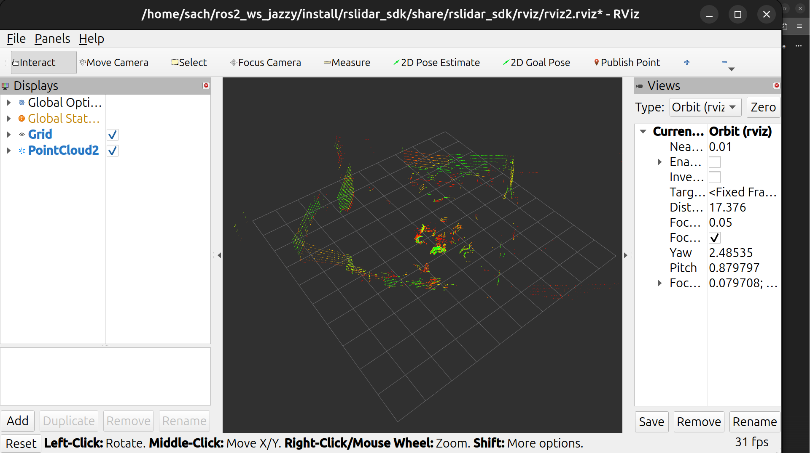

# 03 — ROS and the Vendor Driver

This document covers the ROS 2 acquisition path used to produce the project's
original bag file, and the vendor's open-source (BSD) `rs_driver` C++ library that underpins it.
Understanding both clarifies what our pure-Python decoder re-implements and why
the two stacks are complementary rather than competing.

---

## 1. How it works on ROS

### The rslidar_sdk node

`rslidar_sdk` (v1.5.16, 3-clause BSD) is RoboSense's official ROS 1/2 wrapper for
their C++ `rs_driver` core. In the project workspace it lives at:

```
<ros2_ws>/src/rslidar_sdk/
```

The node is a single executable (`rslidar_sdk_node`) built with `ament_cmake`.
At startup it loads `config/config.yaml`, initialises a `NodeManager` (which owns
an `rs_driver` instance and a ROS publisher), and blocks on `g_cv.wait` until
SIGINT. The relevant excerpt from `config/config.yaml` for this sensor:

```yaml
common:
  msg_source: 1                    # live UDP
  send_point_cloud_ros: true
lidar:
  - driver:
      lidar_type: RSHELIOS_16P
      msop_port: 6699
      difop_port: 7788
      device_ip: "192.168.1.200"
      host_address: "192.168.1.102"
      min_distance: 0.2
      max_distance: 200
      start_angle: 0
      end_angle: 360
    ros:
      ros_frame_id: rslidar
      ros_send_point_cloud_topic: /rslidar_points
      ros_queue_length: 100
```

The node:

1. Opens two UDP sockets (MSOP :6699, DIFOP :7788) bound to `192.168.1.102`.
2. Passes raw packets to the `rs_driver` core for decode (see §2).
3. On each complete revolution (frame split by azimuth wrap), publishes one
   `sensor_msgs/msg/PointCloud2` message on `/rslidar_points` with `frame_id=rslidar`.
4. At 10 Hz spin rate this yields ~10 messages per second, each carrying
   up to 1,800 returns per beam × 16 beams = 28,800 per revolution at 600 rpm; about 24–25k indoors.

ROS 2 dependencies (from `package.xml`): `rclcpp`, `sensor_msgs`, `std_msgs`,
`rslidar_msg`, `yaml-cpp`, `libpcap`, `ament_cmake`.

The launch file (`launch/start.py`) brings up both the driver node and RViz2
with a preconfigured `.rviz` file in a single command:

```bash
ros2 launch rslidar_sdk start.py
```

### Visualising in RViz

Once the node is running, RViz subscribes to `/rslidar_points` and renders the
point cloud in real time. The figures below show the sensor operating in this
configuration.


*The same sensor in RViz via the vendor rslidar_sdk ROS 2 driver.*

`ros2 topic hz /rslidar_points` confirms a steady 10 Hz publication rate.

### Recording the bag — how the original mcap was produced

`ros2 bag record` captures the `sensor_msgs/PointCloud2` stream and writes an
mcap file:

```bash
ros2 bag record /rslidar_points -o helios16p_points
```


This is exactly how the `helios16p_points` mcap used by `--source mcap` was
created. Our `McapSource` reads it back without any ROS installation, using the
`rosbags` Python library. The `--source ros` path (live rclpy subscription)
taps the same `/rslidar_points` topic when ROS is available.

---

## 2. How the vendor driver works

### rs_driver — the BSD C++ core

`rs_driver` is the decode engine that `rslidar_sdk` wraps. It lives at:

```
<ros2_ws>/src/rslidar_sdk/src/rs_driver/
```

It is also released under the 3-clause BSD license and its source is publicly
available. The class hierarchy for our sensor is:

```
Decoder<T_PointCloud>               (base: packet validation, cloud lifecycle)
  └── DecoderMech<T_PointCloud>     (mechanical-lidar geometry, angle tables,
                                     frame-split strategy)
        └── DecoderRSHELIOS_16P<T_PointCloud>   (sensor-specific constants +
                                                  16P channel mapping)
```

`DecoderRSHELIOS_16P` inherits the shared MSOP packet struct
(`RSHELIOSMsopPkt`) and DIFOP struct (`RSHELIOSDifopPkt`) from
`decoder_RSHELIOS.hpp`, which defines the packed wire layout directly as C
structs with `#pragma pack(1)`.

### What the decode does, step by step

The following is a faithful summary of what `internDecodeMsopPkt` (in
`decoder_RSHELIOS_16P.hpp`) and the parent `DecoderMech` perform on each
incoming 1248-byte MSOP packet:

1. **Packet validation** — compares `block.id[2]` against the magic bytes
   `{0xFF, 0xEE}`. A mismatch fires an `ERRCODE_WRONGMSOPBLKID` exception and
   aborts processing of that packet.

2. **Timestamp** — either parsed from the embedded UTC+µs header field
   (`use_lidar_clock: true`) or stamped from the host clock, rolled back by one
   packet duration to align with the first block.

3. **Block iteration** — iterates over all 12 blocks per packet. Each block
   carries `azimuth` as a big-endian uint16 (centi-degrees, 0–35999), read with
   `ntohs(block.azimuth)`.

4. **Frame split on azimuth wrap** — `SplitStrategyByAngle` (or by fixed block
   count) calls `cb_split_frame_` when the azimuth wraps through 0°. This fires
   the ROS publisher callback, which serialises the accumulated points into a
   `PointCloud2` message and publishes it.

5. **Channel loop (32 channels per block)** — for each of the 32 channel slots:

   a. **Laser index**: `laser = chan % 16`. The 16P encodes two interleaved
      firing sequences of 16 beams in the 32 channel slots; only lasers 0–15
      are physically distinct. This is the key difference from the base RSHELIOS
      (32-beam) decoder, which uses `chan` directly.

   b. **Distance**: `distance = ntohs(channel.distance) * 0.0025f` (metres).
      Points outside `[min_distance, max_distance]` are discarded (or emitted as
      NaN if `dense_points: false`).

   c. **Vertical angle calibration**: `angle_vert = chan_angles_.vertAdjust(laser)` —
      per-laser elevation correction loaded from the DIFOP calibration packet
      (`vert_angle_cali[32]`).

   d. **Horizontal angle**: interpolated azimuth for the individual channel using
      the block's azimuth plus a fractional `CHAN_AZIS[chan]` offset (derived
      from per-channel firing timestamps at 1.73 µs intervals within the 55.56 µs
      block window). A per-laser `horiz_angle_cali` correction is then applied.

   e. **Spherical → Cartesian**:
      ```
      x =  d * cos(v) * cos(h) + RX * cos(az)
      y = -d * cos(v) * sin(h) - RX * sin(az)
      z =  d * sin(v) + RZ
      ```
      where `RX = 0.03498 m`, `RZ = 0.0 m` are the lens-centre offsets from
      the rotation axis (from `getConstParam()`).

   f. **Point emission**: `(x, y, z, intensity, timestamp, ring)` is appended to
      the growing point cloud.

### DIFOP — calibration bootstrap

`decodeDifopPkt` parses the 1248-byte DIFOP packet (id `A5 FF 00 5A 11 11 55
55`) once at startup. It extracts:

- 32 vertical-angle calibration values (`vert_angle_cali[32]`)
- 32 horizontal-angle correction values (`horiz_angle_cali[32]`)
- Return mode (single / dual)
- RPM / spin rate

Until a valid DIFOP is received the decoder falls back to nominal angles. The
calibration tables are the mechanism by which per-unit factory adjustments are
communicated to the host; they are baked into each production sensor's DIFOP.

### Our Python decoder — same format, no vendor code

Our `decode_msop_packet` function (in `helios16p/sources/udp_source.py`, with
wire-format constants documented in `docs/PROTOCOL_NOTES.md`) re-implements the
same documented format derived from reading this BSD source: the struct layouts, magic bytes, resolution
constant (0.0025 m), block/channel counts, and laser mapping (`chan % 16`) are
all explicit in the public C++ code. The Python path does not link against or
call any vendor binary; numpy array operations replace the C++ typed-pointer
casts. Both paths apply the sensor's DIFOP calibration (vertical angles and
horizontal offsets per beam); see `07-calibration.md` for how and for the
measured agreement between the two decoders.

---

## 3. Comparison: our decoder vs ROS vs vendor rs_driver

| Dimension | Ours (numpy, no ROS) | ROS (rslidar_sdk) | Vendor rs_driver |
|---|---|---|---|
| **Language** | Python 3 (numpy) | C++ node + Python launch | C++ (header-only templates) |
| **Dependencies** | numpy and the standard library for the decoder; Open3D, VTK, SciPy for processing and display | ROS 2 Jazzy, rclcpp, sensor_msgs, yaml-cpp, libpcap | libpcap, yaml-cpp (no ROS) |
| **Runtime weight** | Single process; the full install is about 2.4 GB, mostly Open3D and VTK | Full ROS daemon stack (rcl, DDS, rviz2 optional) | Standalone C++ library; can be used without ROS |
| **Where decode happens** | Python, inline with pipeline | C++ `rs_driver` core inside ROS node | C++ `rs_driver` core (same code) |
| **Transport / visualisation** | Direct UDP socket; PyVista/VTK viewer | DDS topic `/rslidar_points`; RViz2 | Any; used via rslidar_sdk callback |
| **Recording** | `.npz` raw-packet archive (`helios16p-record`) | `ros2 bag record` → mcap | Not applicable directly |
| **Portability** | Any Python 3 host with a NIC; no ROS needed | Requires ROS 2 Jazzy installation | Requires CMake build; ROS optional |
| **Calibration source** | DIFOP calibration applied per unit (bundled fallback until a DIFOP arrives) | Full DIFOP calibration applied per unit | Full DIFOP calibration applied per unit |
| **When to use** | Real-time pipeline demo; offline replay of raw or mcap data; no ROS environment; lightweight deployment | Initial sensor bring-up; RViz inspection; producing reference mcap bags; ROS-integrated robots | Not used at runtime in this project; reference for wire-format and geometry |

---

## 4. Acquisition path diagram

The three paths from sensor to output:

```
                    ┌─────────────────────────────────────────┐
                    │         RoboSense Helios 16P             │
                    │  MSOP UDP :6699  |  DIFOP UDP :7788      │
                    └───────────────┬─────────────────────────┘
                                    │  raw 1248-byte UDP packets
                  ┌─────────────────┼──────────────────────┐
                  │                 │                       │
                  ▼                 ▼                       ▼
      ┌───────────────────┐  ┌──────────────────┐  ┌──────────────────┐
      │  PATH A — Ours    │  │  PATH B — ROS    │  │  PATH C — Vendor │
      │  (no ROS)         │  │  rslidar_sdk     │  │  rs_driver only  │
      │                   │  │  ROS 2 node      │  │  (reference;     │
      │  socket (Python)  │  │                  │  │  not used here)  │
      │  decode_msop_     │  │  rs_driver C++   │  │                  │
      │  packet (numpy)   │  │  DecoderRSHELIOS │  │  DecoderRSHELIOS │
      │                   │  │  _16P            │  │  _16P            │
      └─────────┬─────────┘  └────────┬─────────┘  └──────────────────┘
                │                     │
                │ Frame               │ sensor_msgs/
                │ (N×3 f32,           │ PointCloud2
                │  intensity,         │ /rslidar_points
                │  ring)              │
                │             ┌───────┴──────────────┐
                │             │                      │
                │             ▼                      ▼
                │         ┌────────┐         ┌──────────────┐
                │         │ RViz 2 │         │ ros2 bag     │
                │         │        │         │ record       │
                │         └────────┘         │ → mcap file  │
                │                            └──────┬───────┘
                │                                   │
                │                           ┌───────┴──────────────┐
                │                           │                      │
                │                           ▼                      ▼
                │                    --source mcap          --source ros
                │                    McapSource             RosSource
                │                    (rosbags lib,          (rclpy,
                │                     no ROS)               lazy import)
                │                           │                      │
                │                           └──────────┬───────────┘
                │                                      │ Frame
                └──────────────────────────────────────┘
                                           │
                                           ▼
                              ┌────────────────────────┐
                              │  ProcessingPipeline     │
                              │  RANSAC ground removal  │
                              │  DBSCAN clustering      │
                              │  Kalman tracking        │
                              │  Virtual gimbal         │
                              └────────────┬───────────┘
                                           │ FrameAnnotations
                                           ▼
                              ┌────────────────────────┐
                              │  PyVista / VTK viewer  │
                              │  (helios16p-demo)     │
                              └────────────────────────┘
```

**Path A** (our stack) is the primary runtime path. It reads the wire directly
and feeds frames to the pipeline without any ROS dependency.

**Path B** (ROS) was used for initial sensor validation and produced the
reference `helios16p_points` mcap. The mcap is then consumable by Path A via
`--source mcap` or `--source ros`, closing the loop between the two stacks.

**Path C** (`rs_driver` standalone) is the C++ implementation from which the
wire format was understood. It is not used at runtime in this project, but its
BSD source serves as the authoritative wire-format reference alongside
`docs/PROTOCOL_NOTES.md`.
