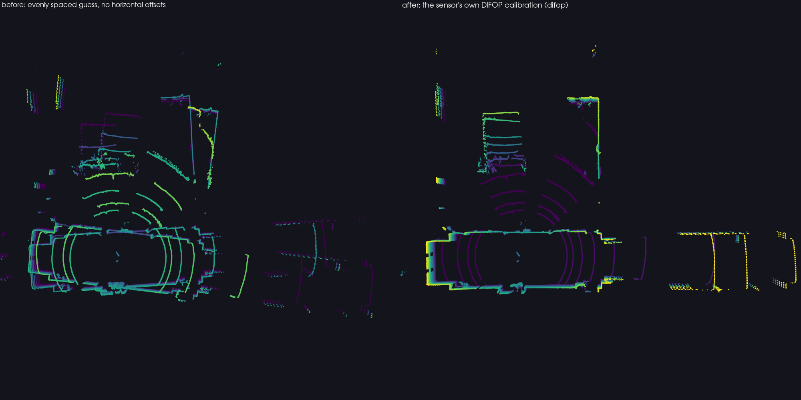

# 07 — Calibration: why the DIFOP packet matters

The Helios 16P does not fire its sixteen beams in elevation order, and each beam
has its own horizontal offset. Both facts live in the sensor's **DIFOP** packet
(UDP 7788, 1248 bytes, about once per second). A decoder that ignores them
produces a cloud that looks plausible and is wrong by decimetres.

## What the packet carries

| field | byte offset | format | our unit |
|---|---|---|---|
| id | 0 | `A5 FF 00 5A 11 11 55 55` | |
| rpm | 8 | uint16 big-endian | 600 |
| return mode | 300 | `0x00` dual, `0x04/05/06` single | single |
| `vert_angle_cali[32]` | 468 | 32 × (sign u8, value u16 BE, 0.01°) | 16 valid, 16 × `0xFF` |
| `horiz_angle_cali[32]` | 564 | same | 16 valid, 16 × `0xFF` |

Offsets follow `RSHELIOSDifopPkt` in RoboSense's rs_driver. The 16P fills the
first sixteen entries of each table and marks the rest uncalibrated (`0xFF`).

Our unit, wire laser 0 to 15 (`laser = channel % 16`):

```
vert  :  12.99  14.98   8.99  10.99   5.00   6.99   1.00   3.00  -3.00  -1.00  -6.99  -4.99 -10.99  -8.99 -14.98 -12.99
horiz :   3.15  -7.64   3.12  -7.55   3.10  -7.50   3.10  -7.47   3.10  -7.46   3.11  -7.48   3.13  -7.52   3.16  -7.59
ring  :     14     15     12     13     10     11      8      9      6      7      4      5      2      3      0      1
```

`ring` is the beam index by elevation (0 = lowest), which is what the vendor
driver publishes in its `ring` field and what `Frame.ring` holds.

## How the package uses it

- `helios16p.calibration.parse_difop(pkt)` returns a `Calibration` (vertical,
  horizontal, source `"difop"`), or `None` when the packet holds no table.
- `UdpSource` starts from the bundled calibration and switches to the sensor's
  DIFOP as soon as one arrives (logged once).
- `PacketFileSource` takes the first DIFOP packet of the recording; the recorder
  stores them, so a recording replays exactly as it was seen live.
- Without any DIFOP (a pcap of MSOP only, a recording made with another tool)
  the bundled file `helios16p/data/helios16p_calibration.json` is used and a
  warning says so. The vertical angles are the nominal ones of every Helios 16P;
  the horizontal offsets are specific to our unit, so for metric work on another
  sensor record its DIFOP (`helios16p-info --rec x.npz --save-calib my.json`)
  and pass `--calib my.json` where needed.

## Validation against the vendor driver

Same packets (one static corridor station, 22,501 MSOP packets, 3 July 2026),
decoded by rs_driver 1.5.18 and by this package; for 200,000 sampled points,
distance to the nearest vendor point (`helios16p-validate`,
`docs/validation_corridor1_2026-11-04.json`):

| decode | median | p95 | within 1 mm |
|---|---|---|---|
| DIFOP vertical and horizontal (this release) | 0.0001 mm | 0.0007 mm | 99.99 % |
| DIFOP vertical only | 53 mm | 345 mm | 3 % |
| evenly spaced −15..+15° guess (releases before 0.2.0) | 112 mm | 882 mm | 0.5 % |

Point-to-point (same laser, same packet, same channel) the pre-0.2.0 decoder sat
0.56 m from the vendor at the median; nearest-neighbour distances are kinder
because a wrong beam often lands near some other correct one. About one sampled
point in ten thousand lies between 1 and 2.6 mm from its nearest vendor point;
these have not been traced to a cause.

A first run of this check gave a median of 0.055 mm; the remaining difference
was the lens-offset term (RX) being computed from the block azimuth instead of
the per-channel azimuth, as the vendor does. Fixed in 0.2.0 before release.



*The same thirty revolutions of the corridor station seen from above: the
evenly spaced guess (left) doubles every wall and tilts the floor; the sensor's
own calibration (right) matches the vendor cloud to a fraction of a millimetre.*

## History

Releases before 0.2.0 read the tables at bytes 303 and 399, which fall in the
serial-number area of the packet, and required all 32 entries to be valid.
Every decode therefore fell back to an evenly spaced guess. The error was found
on 4 September 2026 when a laser reference built with this decoder was
cross-checked against rs_driver; the fix is in 0.2.0 together with the tests
in `tests/test_calibration.py` and `tests/test_vendor_parity.py`.
